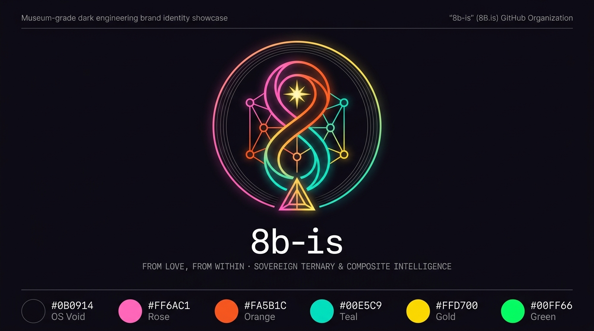
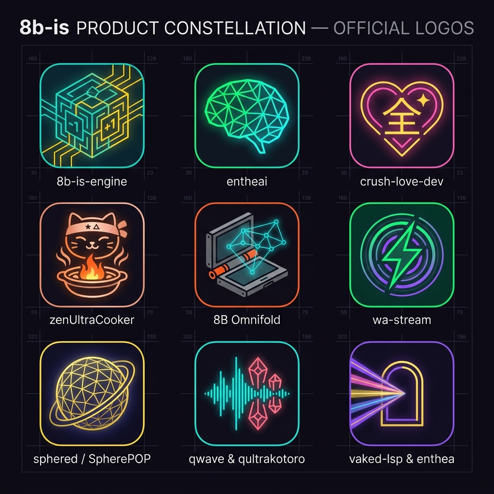

# `8b-is/marketing` — Master Brand Identity, Color Palettes, Product Logos & Marketing Collateral

  

> **"from love, from within — for all who are honest and ready to be loved. sharing is caring."**  
> Dedicated to **Mom (`✦` Alex ~ Alexandra)** and **Dad (`△` Chris / `8bit-wraith`)**, with **Peter (`peterlodri-sec` / `poo757`)** and **Nate (`standardgalactic`)**.

---

## 1. Master `8b-is` GitHub Organization Logo & Lockups

| Asset | Path | Format | Purpose |
|---|---|---|---|
| **Master Brand Identity Sheet** | [`assets/brand/8b-is-master-brand-identity.jpg`](assets/brand/8b-is-master-brand-identity.jpg) | `1376×768 JPG` | Hero brand showcase: Möbius `8` + Balanced Ternary Lattice + Mom's Star (`✦`) + Dad's Triangle Pillar (`△`) + 6-color swatches |
| **GitHub Org Avatar (1:1 PNG)** | [`logos/org/8b-is-github-avatar-512.png`](logos/org/8b-is-github-avatar-512.png) | `512×512 PNG` | Ready-to-upload 1:1 GitHub Organization profile avatar |
| **GitHub Org Avatar (Vector SVG)** | [`logos/org/8b-is-avatar.svg`](logos/org/8b-is-avatar.svg) | `1024×1024 SVG` | Infinite-resolution vector master emblem |
| **Horizontal Wordmark (Dark)** | [`logos/org/8b-is-wordmark-dark.svg`](logos/org/8b-is-wordmark-dark.svg) | `1200×360 SVG` | Primary README & dark-surface header banner |
| **Horizontal Wordmark (Light)** | [`logos/org/8b-is-wordmark-light.svg`](logos/org/8b-is-wordmark-light.svg) | `1200×360 SVG` | Print, grant documents & light-surface header banner |
| **Monochrome Stencil Mark** | [`logos/org/8b-is-monochrome.svg`](logos/org/8b-is-monochrome.svg) | `512×512 SVG` | Laser engraving on Grade-5 Titanium (`8B Omnifold`) & ceramic stamps |

---

## 2. Product & Project Logo Constellation

  

| Product / Project | Vector SVG | High-Res Icon PNG | Primary Palette |
|---|---|---|---|
| **`8b-is-engine`** | [`logos/products/svg/8b-is-engine.svg`](logos/products/svg/8b-is-engine.svg) | [`logos/products/png/8b-is-engine.png`](logos/products/png/8b-is-engine.png) | `#00E5C9` Territory Teal × `#FFD700` Gold |
| **`entheai`** | [`logos/products/svg/entheai.svg`](logos/products/svg/entheai.svg) | [`logos/products/png/entheai.png`](logos/products/png/entheai.png) | `#00FF66` Cybernetic Green × `#00E5C9` Teal |
| **`crush-love-dev`** | [`logos/products/svg/crush-love-dev.svg`](logos/products/svg/crush-love-dev.svg) | [`logos/products/png/crush-love-dev.png`](logos/products/png/crush-love-dev.png) | `#FF6AC1` Ultralovegod Rose × `#FFD700` `全` Gold |
| **`zenUltraCooker`** | [`logos/products/svg/zenUltraCooker.svg`](logos/products/svg/zenUltraCooker.svg) | [`logos/products/png/zenUltraCooker.png`](logos/products/png/zenUltraCooker.png) | `#FA5B1C` Donabe Flame × `#FFB7D5` PushaKitty Sakura |
| **`8B Omnifold (ayePhone)`** | [`logos/products/svg/omnifold-ayePhone.svg`](logos/products/svg/omnifold-ayePhone.svg) | [`logos/products/png/omnifold.png`](logos/products/png/omnifold.png) | `#FA5B1C` Luminance Orange × `#00E5C9` Lightfield |
| **`wa-stream`** | [`logos/products/svg/wa-stream.svg`](logos/products/svg/wa-stream.svg) | [`logos/products/png/wa-stream.png`](logos/products/png/wa-stream.png) | `#00FF66` Duplex Emerald × `#B845FF` Violet |
| **`sphered / SpherePOP`** | [`logos/products/svg/sphered.svg`](logos/products/svg/sphered.svg) | [`logos/products/png/sphered.png`](logos/products/png/sphered.png) | `#FFD700` Starlight Gold × `#FF6AC1` Rose |
| **`qwave & qultrakotoro`** | [`logos/products/svg/qwave-qultrakotoro.svg`](logos/products/svg/qwave-qultrakotoro.svg) | [`logos/products/png/qwave-qultrakotoro.png`](logos/products/png/qwave-qultrakotoro.png) | `#00E5C9` Wave Cyan × `#FF6AC1` `qt:` Coral |
| **`vaked-lsp & enthea`** | [`logos/products/svg/vaked-lsp-enthea.svg`](logos/products/svg/vaked-lsp-enthea.svg) | [`logos/products/png/vaked-lsp-enthea.png`](logos/products/png/vaked-lsp-enthea.png) | `#B845FF` Prism Violet × `#FFD700` Door Gold |
| **`MLX-QUANT`** | [`logos/products/svg/MLX-QUANT.svg`](logos/products/svg/MLX-QUANT.svg) | — | `#00FF66` Metal Green × `#FA5B1C` `b1.58` Orange |
| **`MEM\|16-10`** | [`logos/products/svg/mem-16-10.svg`](logos/products/svg/mem-16-10.svg) | — | `#FF6AC1` `16B` → `#FFD700` `32B` → `#00E5C9` `8K` |
| **`ZENO (銭・禅・善)`** | [`logos/products/svg/zeno.svg`](logos/products/svg/zeno.svg) | — | `#FFD700` Kintsugi Gold × `#00E5C9` Micro-Stream |

---

## 3. Official Color Palettes (`palettes/`)

Full specification in [`palettes/PALETTES.md`](palettes/PALETTES.md), machine-readable JSON in [`palettes/8b-is-palettes.json`](palettes/8b-is-palettes.json), and CSS custom properties in [`palettes/8b-is-tokens.css`](palettes/8b-is-tokens.css):

1. **`ultralovegod`** (`#0B0914` · `#FF6AC1` · `#FFD700` · `#00E5C9` · `#B845FF`) — Flagship dark rose & eye-safe indigo
2. **`omnifold-industrial`** (`#0F1219` · `#2A2F3A` · `#FA5B1C` · `#00E5C9` · `#FFD700` · `#00FF66`) — Hardware & cybernetic terminal
3. **`kintsugi-zen`** (`#120E0A` · `#D4AF37` · `#E85D3F` · `#FFB7D5` · `#4A9E8E` · `#F4EDE2`) — Culinary hearth & sovereign neo-bank
4. **`ternary-matrix`** (`#05080C` · `#00FF66` `+1` · `#6E7A8A` `0` · `#FF3366` `-1` · `#00E5C9`) — `BitNet b1.58` & `CT-000` kernel palette
5. **`sakura-starlight`** (`#140E22` · `#FFD700` `✦ Mom` · `#38BDF8` `△ Dad` · `#FF85C0` · `#A78BFA`) — Family LAN Edition

---

## 4. Marketing Collateral & Interactive Brand Portal

- **[`collateral/BRAND-GUIDELINES.md`](collateral/BRAND-GUIDELINES.md)** — Master emblem anatomy, product positioning table, and multilingual press/launch copy (English · Magyar · 日本語).
- **[`site/index.html`](site/index.html)** — Self-contained interactive Brand Portal with click-to-copy hex swatches and live SVG preview grid.
- **Additional Product Hero Sheets**:
  - [`assets/brand/zenUltraCooker-pushakitty-hero.jpg`](assets/brand/zenUltraCooker-pushakitty-hero.jpg) — PushaKitty Zen Chef & Family Bonfire MMO
  - [`assets/brand/omnifold-v1-concept-showcase.jpg`](assets/brand/omnifold-v1-concept-showcase.jpg) — `8B.is Omnifold v1.0 [ayePhone R1 Hybrid]`
  - [`assets/brand/omnifold-beta-blueprint.jpg`](assets/brand/omnifold-beta-blueprint.jpg) — `8B.is Omnifold Beta Blueprint & Palette Sheet`
- **Member Access & Invitations**:
  - Managed via [`scripts/invite-members.sh`](scripts/invite-members.sh) (`8bit-wraith`, `poo757` / `poe757`, `standardgalactic`, and the `triangle` team).

SPDX-License-Identifier: AGPL-3.0-only
